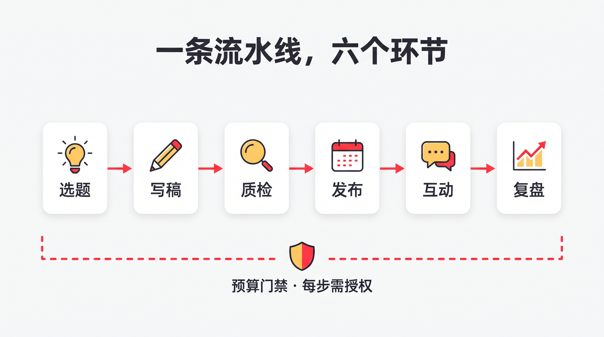
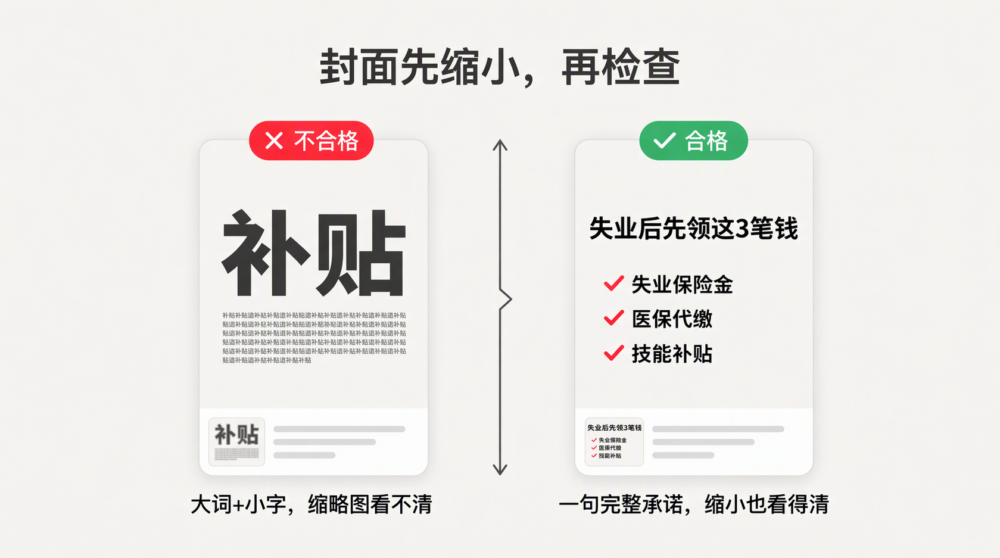

# 小红书运营助手 · 图文使用指南

> 配套技能：`xiaohongshu-ops-sop` v1.0.0
> 读完你能做到：装好技能 → 填好账号信息 → 每天动嘴让 AI 按规矩运营 → 看得懂它给你的报告。
> 全程大白话，命令可以直接复制。



---

## 一、这个技能是什么

一句话：**把一套真实跑通过的小红书运营流程，装进你的 AI 助手。**

它不是「帮你写文案的提示词」，而是一条流水线：选题 → 写稿 → 质检 → 发布 → 互动 → 复盘。每个环节有规矩、有检查工具，花钱的环节还有预算闸门。你负责拍板，它负责干活和把关。

## 二、安装（二选一）

**方法一：千问（QwenWork）里一键装**
拿到 `xiaohongshu-ops-sop.skill` 文件（GitHub 仓库 `listing/` 目录里有），在 QwenWork 里打开，点「保存技能」即可。

**方法二：手动放目录**
把技能文件夹整个放到你的技能目录，例如：

```text
~/.qwenwork/skills/xiaohongshu-ops-sop/
```

装好后对 AI 说一句「加载小红书运营技能」，它就知道该怎么做了。

**环境要求**：电脑上有 Python 3.10 以上，装一个依赖：

```bash
python3 -m pip install pyyaml
```

就这一个。其他脚本都不需要额外安装。

## 三、初始化：给账号建个工作区

对 AI 说：「帮我初始化小红书工作区」。它会执行：

```bash
python3 scripts/init_workspace.py /你的工作目录 --account-name "你的账号名"
```

执行完会得到一个配置文件 `xiaohongshu-ops.yaml` 和几个数据文件夹。

**然后填配置**——打开 yaml，把所有 `__占位符__` 换成你自己的信息：

| 要填的 | 填什么 | 例子 |
|---|---|---|
| 账号定位 | 你帮谁解决什么问题 | 给打工人的省钱办事清单 |
| 目标人群 | 你的读者是谁 | 25–35 岁上班族 |
| 内容支柱 | 你常讲的 3–4 类话题和占比 | 省钱 60% / 防坑 25% / 试验 15% |
| 地域词 | 你的城市、省份 | 杭州、浙江 |
| 搜索词 | 垂类词 + 场景词组合 | 社保 离职、公积金 提取 |
| 目标值 | 现阶段想要的数据 | 按默认基线先跑，之后按实际调 |

填完跑一下体检：

```bash
python3 scripts/doctor.py --config xiaohongshu-ops.yaml
```

看到 `PASS` 就绪。它还提醒你哪些占位符没填，照着补就行。

## 四、日常怎么用：这样说就行

装好之后不需要记命令，**用日常话术派活**，AI 会自己去跑对应流程：

| 你想要 | 直接说 | 它会做什么 |
|---|---|---|
| 选题 | 「今天发什么」「给我排一周选题」 | 按你的内容支柱和近期数据出选题，每个都写清给谁看、看完能做什么 |
| 写内容 | 「写一篇笔记，主题是 XX」 | 标题、封面承诺、正文结构、出处一起给，不是只给一段文案 |
| 审稿 | 「这条能不能发」 | 先缩到手机大小查封面，再查事实、数字、合规，不合格直接退回 |
| 发布 | 「这条发布，挂明早 7 点半」 | 先跑发布包检查，你授权后才动浏览器，发完回读平台确认真发成功 |
| 复盘 | 「帮我复盘这周数据」 | 出 14 维报告，缺的数据标「未取到」，最后落到下一步改什么 |
| 评论 | 「回复一下评论区」 | 只回真实提问，结论→依据→最多一个反问，不硬聊 |
| 外联 | 「做一轮外联」 | 先出计划再执行，评论贴原帖细节、不导流，遇风控立刻停 |

**记住一个原则：动嘴派活，动手授权。** 凡是发布、评论、关注、私信、花钱生成，它都会先问你，你点头才做。

## 五、封面是怎么把关的（这个技能最较真的地方）



在小红书，用户只看到一块豆腐干大的缩略图，半秒决定点不点。所以这个技能做封面有六步死规矩：

1. **先写句子再做图**：封面承诺必须先是一句完整的话——谁 + 什么情况 + 能做什么 + 数字结果。「大抽象词 + 小字解释」直接禁止。
2. **一卡一件事**：每张图只讲一个点，不混装。
3. **字号是硬指标**：关键文字 ≥38 像素、辅助 ≥30、出处 ≥26，对比度要够。
4. **先缩小再检查**：生成 270 像素宽的手机预览，3 秒读不清就重做，「有设计感」不是理由。
5. **机器把关**：复核逐项记录，发布前工具核对，对不上就拦下。
6. **数字必须兑现**：写「3 笔钱」就得列出 3 笔独立的钱，机器会数。

**风格统一又不重复**：同一篇笔记里，标题位置、字号、编号、页脚全统一，像一套模板；不同笔记之间，配色、版式、字体轮着换，连续 3 条不重复同一套视觉。读者记得住你的号，又不会看腻。

## 六、安全边界：它不会自作主张

- **不授权不动手**：发布、评论、点赞、关注、私信、删除，每一样都要你当次明确同意。
- **不自动挂定时**：定时任务必须你开口才建。
- **花钱先过闸门**：AI 生图生视频这类按次收费的，先确认「这条要发」→ 先出免费草稿 → 报预算拿到你「同意」→ 才开工，每笔记账，超额自动停。
- **遇风控就停**：验证码、操作频繁、登录失效，立刻收手，不硬闯、不换号绕。
- **不编数据**：报告里缺的数字就写「未取到」，绝不估算凑数。

## 七、常见问题

**问：doctor 报了一堆 WARN？**
看内容：`placeholder` 是占位符没填完，照着补；`workspace` 是文件夹还没建，跑一次初始化就好。只有 `ERROR` 才必须处理。

**问：提示没有 PyYAML？**
`python3 -m pip install pyyaml`。如果你电脑有多个 Python，用哪个跑脚本就给哪个装。

**问：我没有浏览器自动化工具，能用吗？**
能。选题、写稿、审稿、封面质检、数据报告、外联计划这些都不需要浏览器。只有「替你实际发布/评论」需要浏览器适配器（Playwright MCP、Chrome 扩展 MCP 都行），没有就人工照着它给的发布包操作。

**问：默认数字不适合我的号怎么办？**
全在 `xiaohongshu-ops.yaml` 里：发布窗口、每天几条、外联上限、评论字数、目标值，改完跑一次 doctor 校验即可。规则是死的，参数是你的。

**问：测试怎么跑？**

```bash
python3 -m unittest discover -s tests -v
```

21 项全过说明脚本环境正常。

## 附：命令速查（可截图保存）

```bash
# 初始化工作区
python3 scripts/init_workspace.py . --account-name "账号名"
# 配置体检
python3 scripts/doctor.py --config xiaohongshu-ops.yaml
# 今日外联计划
python3 scripts/plan_outreach.py --config xiaohongshu-ops.yaml --format md
# 评论批次质检
python3 scripts/lint_comments.py --config xiaohongshu-ops.yaml --input comments.json
# 发布包检查（图文）
python3 scripts/check_publish_package.py publish/笔记目录 --config xiaohongshu-ops.yaml --kind image
# 数据报告
python3 scripts/analyze_metrics.py --config xiaohongshu-ops.yaml --input data/metrics.json --markdown data/reports/analysis.md
# 付费生成预算闸门
python3 scripts/gen_guard.py plan --file plan.json
```

> 小红书卡片版指南见同目录「使用指南卡片」文件夹，8 张图可直接发布或转发。