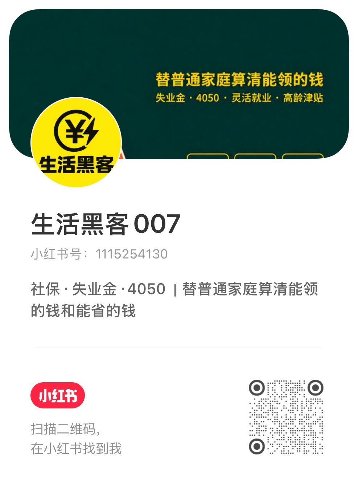

# 实战案例：生活黑客007

这个技能不是纸上谈兵——它的每一条规则，都来自下面这个账号的真实运营。

## 账号信息

| 项目 | 内容 |
|---|---|
| 账号名 | 生活黑客007 |
| 小红书号 | 1115254130 |
| 主页 | https://www.xiaohongshu.com/user/profile/6003b7f200000000010090a4 |
| 定位 | 替普通家庭算清能领的钱：失业金、4050、灵活就业、高龄津贴 |
| 内容主线 | 钱/权益为主，安全防坑、家庭照护为辅 |

扫二维码，在小红书找到这个账号。

## 技能里的规则，在这个号上是怎么来的

- **「1 图文 + 1 视频」的每日上限**：这个号实测出来的节奏——发多了互相抢流量，不如每条做扎实。
- **封面 V01–V10 硬规则**：来自一次真实翻车——政策内容全对，但首图「大词 + 小字」手机缩略图看不清，数据照样扑街。从此封面先缩到 270px 检查，看不清就重做。
- **「数字必须兑现」**：曾把同一项救助的两种情形包装成「2 笔钱」，被判定承诺不可兑现。从此标题写几笔，正文就得列出几笔独立的钱。
- **双池外联 15+15、评论 ≤30 字**：长期跑出来的分寸——评论贴原帖细节、不导流、限量限速，账号才安全，主页回访才真实。
- **付费生成预算门禁**：一条 42 秒视频烧掉几十次付费调用换来的教训——先确认要发、先出免费草稿、报预算拿到同意才花钱。
- **发布后必须回读**：踩出过重复发布、定时池撞车的坑，从此「点击成功」不算数，平台状态回读一致才算完成。

## 你可以照抄什么

1. 把技能的配置模板复制一份，定位、人群、支柱换成你自己账号的。
2. 先跑两周「每天最多 1 图文 + 1 视频 + 限量外联」，用 14 维报告看数据。
3. 按报告一次只改一个变量，逐步把参数调成适合你账号的数值。

规则是这个号跑出来的，参数应该长成你自己账号的样子。